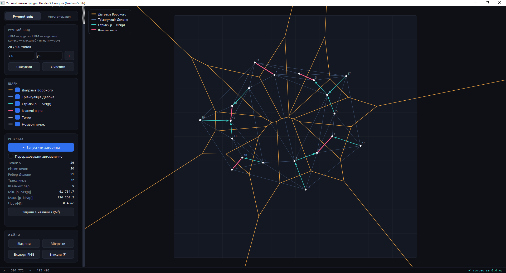
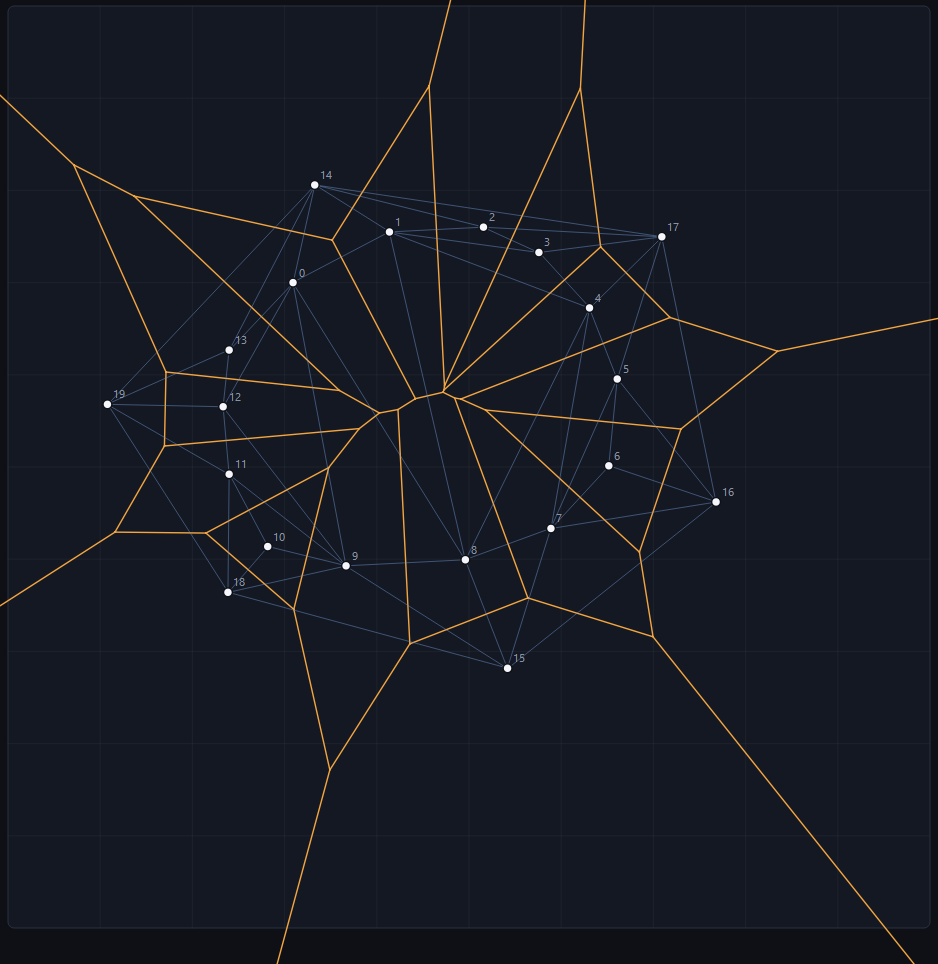
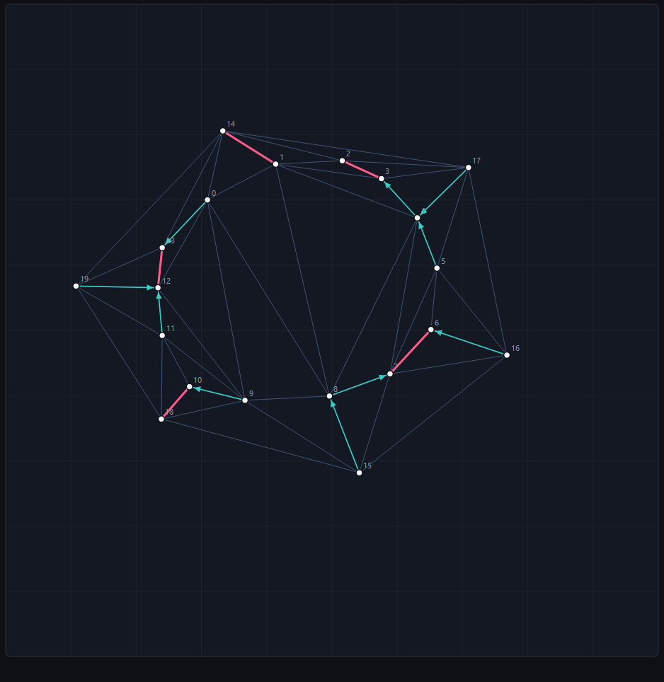
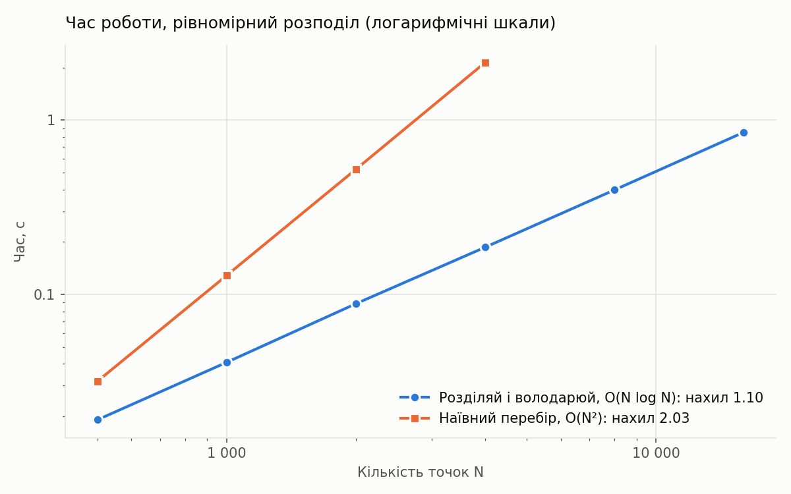
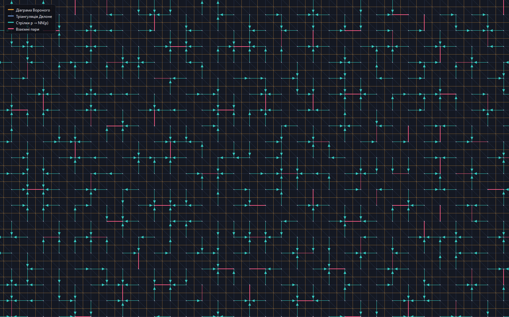

<div align="center">

# All Nearest Neighbors

**For every point in a planar set, find its closest neighbor in optimal *O(N log N)* time.**

Divide-and-conquer Delaunay triangulation (Guibas–Stolfi) · exact integer predicates · interactive Qt visualizer


-41CD52?logo=qt&logoColor=white)

-blueviolet)




</div>

---

## The problem

Given a set **S** of *N* points in the plane, find for **every** point *p* the point *q ∈ S, q ≠ p* closest to it.

It sounds simple, but the obvious solution checks all *N(N−1)/2* pairs: that is 50 million distance computations for just 10 000 points. The relation is also **not symmetric** (*q* can be nearest to *p* while *q*'s own nearest neighbor is someone else), so the problem does not reduce to the classic *closest pair*.

This project solves it in **Θ(N log N)**, which matches the known lower bound for the problem, and does so correctly on every degenerate input: duplicates, collinear points, cocircular points and grids.

> Built as a lab assignment for the *Computational Geometry* course at Taras Shevchenko National University of Kyiv (Faculty of Mechanics and Mathematics), task АБ1 №46.

## Key idea

**Theorem.** If *q* is a nearest neighbor of *p*, then *pq* is an edge of **every** Delaunay triangulation of *S*.

*Proof sketch.* Any point inside or on the circle with diameter *pq* would be strictly closer to *p* than *q*. So that circle is empty, and an edge with an empty circle through its endpoints belongs to the Delaunay triangulation. ∎

So instead of comparing all pairs, it is enough to:


The Voronoi diagram comes for free: it is the dual graph of the triangulation and is built in *O(N)* only for visualization.

<table>
<tr>
<td align="center"><br><sub>Delaunay triangulation and Voronoi diagram</sub></td>
<td align="center"><br><sub>Arrows <i>p → NN(p)</i>, mutual pairs in pink</sub></td>
</tr>
</table>

## How it works

| Step | What happens | Cost |
|---|---|---|
| **Divide** | Sorted points are split at the median into left and right halves | *O(1)* |
| **Conquer** | Delaunay triangulations of both halves are built recursively; base cases are 2 or 3 points | *2T(N/2)* |
| **Merge 1** | Find the lower common tangent of the two convex hulls | *O(N)* |
| **Merge 2** | "Zip" the halves bottom-up: delete edges that violate the empty-circle condition, add cross edges | *O(N)* |
| **Answer** | For each point, pick the shortest incident triangulation edge | *O(N)* |

Every edge is added and deleted at most once during a merge, so the merge is linear and the recurrence *T(N) = 2T(N/2) + O(N)* gives ***O(N log N)***.

### Engineering details

- **Exact arithmetic.** Coordinates are integers, and all geometry reduces to two determinant signs, `ccw` (orientation) and `in_circle`. Python's arbitrary-precision `int` evaluates them exactly, so there are no rounding errors and no special cases for degenerate input.
- **Quad-edge structure** (Guibas & Stolfi, 1985) stores the triangulation and its dual Voronoi diagram at the same time; every topological operation is *O(1)*.
- **Deterministic output.** Among equidistant neighbors the one with the smaller index is chosen, so the result matches brute force *index for index*, not just by distance.
- **No UI freezes.** Computation runs in a background thread; stale results are discarded if the input changes mid-computation.

## Performance

Uniformly distributed points, single core:

| N | Divide & conquer | Brute force *O(N²)* | Speed-up |
|---:|---:|---:|---:|
| 1 000 | 0.04 s | 0.13 s | ×3.2 |
| 2 000 | 0.09 s | 0.52 s | ×5.9 |
| 4 000 | 0.19 s | 2.14 s | ×11.5 |
| 16 000 | 0.85 s | ≈ 34 s *(extrapolated)* | ≈ ×40 |

On a log–log plot the empirical slope is **1.10** for this algorithm versus **2.03** for brute force. The normalized time *T(N) / (N log₂ N)* stays almost constant across six input distributions, including the worst cases.

<p align="center"></p>

Degenerate inputs are handled correctly and are actually *faster* than random ones:

<p align="center"><br><sub>100 × 100 grid: maximum number of cocircular quadruples, 4 equidistant neighbors per point</sub></p>

## Features of the visualizer

- **Manual input:** click to add up to 100 points, right-click to delete, or type coordinates
- **Generation:** up to 20 000 points from 6 distributions: uniform, Gaussian, clusters, grid, collinear, circle; reproducible via `seed`
- **Run button** or automatic recomputation on every change
- **Layers:** Delaunay triangulation, Voronoi diagram, *p → NN(p)* arrows, mutual pairs, point labels
- **Pan & zoom**, hover tooltips showing each point's neighbor
- **Brute-force check:** one click compares the result with *O(N²)* element by element and shows both timings
- **Statistics:** edges, triangles, mutual pairs, min/max NN distance, run time
- Open/save point sets as text files, export the canvas to PNG

## Getting started

```bash
git clone https://github.com/kyrylobatrak/all-nearest-neighbors.git
cd all-nearest-neighbors

python -m venv .venv
# Windows: .venv\Scripts\activate    Linux/macOS: source .venv/bin/activate
pip install -r requirements.txt
```

| Command | What it does |
|---|---|
| `python ui/app.py` | launch the interactive visualizer |
| `python -m pytest` | run the 156 tests |
| `python benchmarks/benchmark.py` | re-run benchmarks and regenerate the plots |

### Use as a library

```python
import sys; sys.path.insert(0, "src")

from geometry import Point
from nearest import all_nearest_neighbors

pts = [Point(0, 0), Point(5, 0), Point(6, 1), Point(20, 20)]
print(all_nearest_neighbors(pts))   # [1, 2, 1, 2]
```

`result[i]` is the index of the nearest neighbor of `points[i]`.

Point-set file format for **Open/Save**: one point per line, two integers `x y` in `[0, 10⁶]`; anything after `#` is a comment.

## Project structure

```
all-nearest-neighbors/
├── src/
│   ├── geometry.py      # Point, exact ccw / in_circle predicates
│   ├── quadedge.py      # Guibas–Stolfi quad-edge structure
│   ├── delaunay.py      # divide-and-conquer Delaunay triangulation
│   ├── nearest.py       # all nearest neighbors, O(N log N)
│   ├── brute_force.py   # O(N²) reference implementation
│   ├── voronoi.py       # Voronoi diagram as the dual, O(N)
│   ├── generator.py     # 6 point distributions, including worst cases
│   └── scene.py         # rendering-agnostic scene preparation
├── ui/app.py            # PySide6 visualizer
├── tests/               # 156 pytest tests
├── benchmarks/          # timing script, CSV and plots
├── report/              # full lab report (PDF, Ukrainian)
└── docs/images/         # screenshots for this README
```

## Testing

156 tests cover:

- exactness of the predicates on near-degenerate configurations;
- quad-edge invariants;
- the Delaunay property itself: empty circumcircles, Euler's formula *V − E + F = 2*, convex outer boundary;
- degenerate cases: *N = 0, 1, 2*, duplicates, collinear and cocircular points, square grids;
- index-for-index agreement with brute force on 500+ random sets and *N* up to 2000.

An extra 3000 random sets were checked outside the test suite with zero mismatches.

## Report

- 📄 **Full report** (Ukrainian, 30 pages): problem statement, proofs, step-by-step complexity analysis, experiments: [`report/Batrak_ANN_zvit.pdf`](report/Batrak_ANN_zvit.pdf)

## References

1. L. Guibas, J. Stolfi. *Primitives for the manipulation of general subdivisions and the computation of Voronoi diagrams.* ACM Transactions on Graphics 4(2), 1985.
2. F. P. Preparata, M. I. Shamos. *Computational Geometry: An Introduction.* Springer, 1985.
3. M. I. Shamos, D. Hoey. *Closest-point problems.* FOCS 1975.
4. S. Ebadian, H. Zarrabi-Zadeh. *A simple randomized algorithm for all nearest neighbors.* CCCG 2019.

The full bibliography (13 sources) is in the report.

## License

[MIT](LICENSE) © 2026 Kyrylo Batrak
